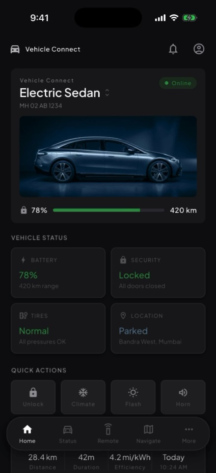
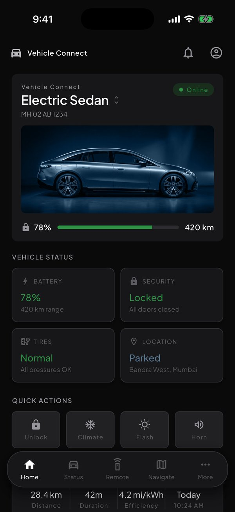
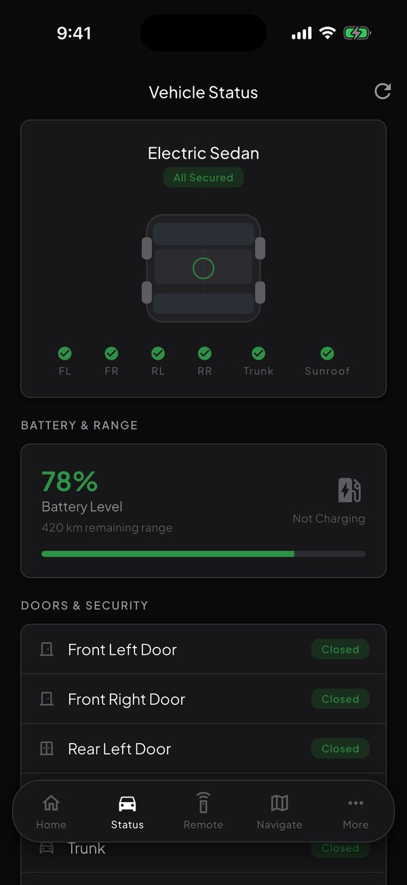
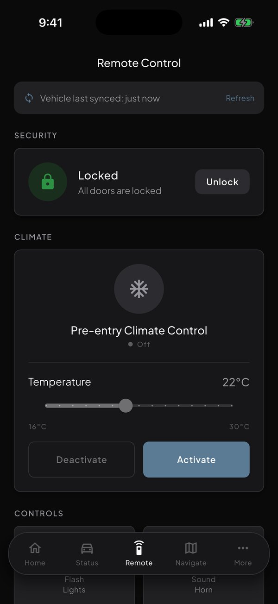
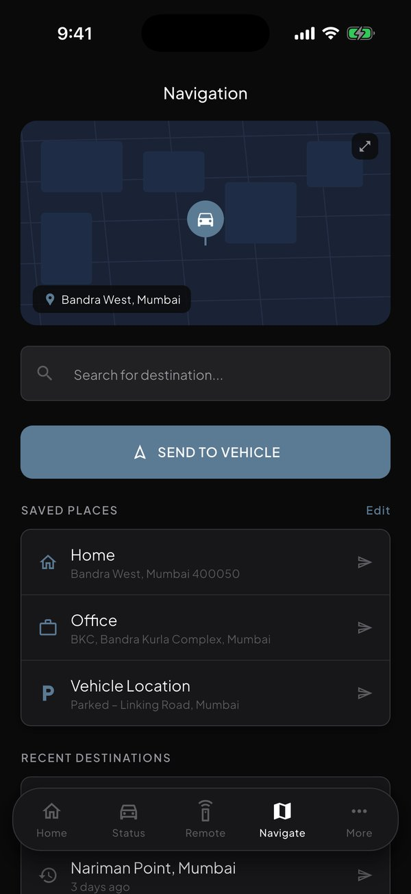
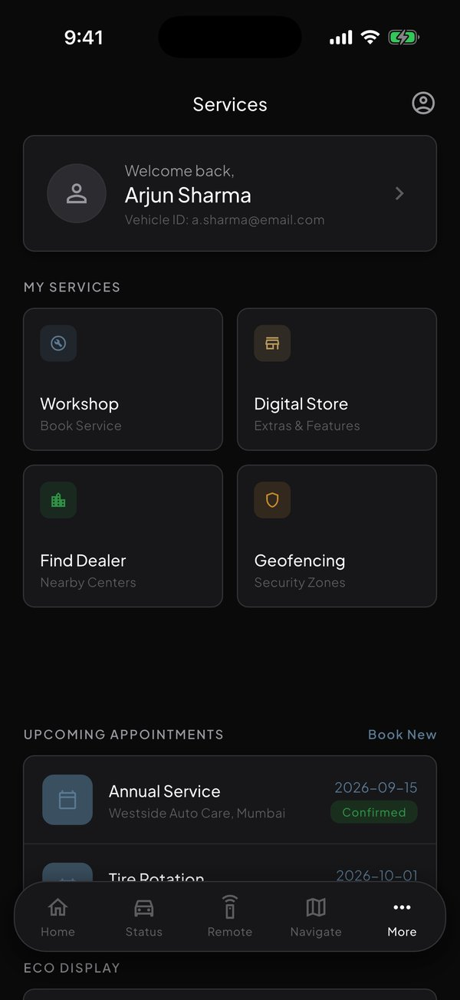
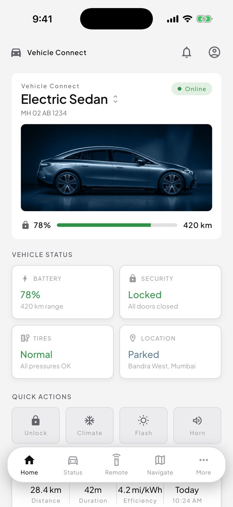

<p align="center"></p>

<h1 align="center">MyCar</h1>
<p align="center"><b>A Flutter companion app for connected cars.</b><br>Lock & unlock, climate, remote start, vehicle status, navigation and service booking, built with Clean Architecture.</p>

<p align="center">
  <a href="media/tour.mp4"></a><br>
  <sub>▶ <a href="media/tour.mp4">Watch the 28-second tour</a> (recorded on the iOS Simulator)</sub>
</p>

> **Showcase repo.** The source code is private. This repo holds screenshots, a video tour and the feature list.

## Screenshots

| Home | Vehicle Status | Remote Control |
|:-:|:-:|:-:|
|  |  |  |
| **Navigation** | **Services** | **Light theme** |
|  |  |  |

## Features

- **Home**: vehicle overview, charge & range, status tiles, quick actions, last journey
- **Vehicle Status**: battery, doors, trunk & sunroof, tire pressure, lock state
- **Remote Control**: lock/unlock, pre-entry climate, sunroof, remote start, flash & horn
- **Navigation**: map, destination search, send to vehicle, saved places & recent destinations
- **Services**: workshop booking, dealer finder, digital store, geofencing alerts
- Multiple vehicles, light & dark themes, selectable accent colours, English & German

## Architecture

```
lib/
  domain/        entities, repository interfaces, use cases (one class per mutation)
  data/          repository implementations (mocked, no backend)
  presentation/  Cubits, theme, router, shared widgets, feature screens
  core/di/       a small manual service locator
```

- State management with `flutter_bloc` Cubits, navigation with `go_router`
- Localisation with `flutter gen-l10n` (English, German)
- CI on GitHub Actions (`flutter analyze`, `flutter test`) and Codacy quality grading on every PR
- Git flow: `main`, `develop`, `feature/*`, `release/*`, `hotfix/*`

## Built with

Flutter · Dart · flutter_bloc · go_router · Clean Architecture · GitHub Actions · Codacy

---
Made by [Anil Upadhyay](https://github.com/anil291987) · [LinkedIn](https://www.linkedin.com/in/anil-u-a70061a7/)
